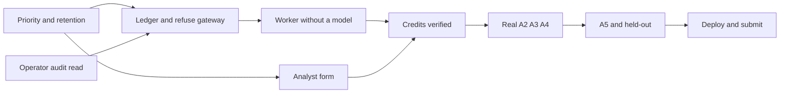

# Complete the Genesis workflow

The drafted path is evidence, Gemini triage, analyst review, then an evaluated proposal. Live Gemini, Cloud Tasks, deploy, and submission stay off until `CREDITS_VERIFIED` is true. Nothing in an earlier phase may invent a model result so that feedback or Evolution can proceed.

Default is sequential. Two overlaps are safe. Everything else waits, because the next step reads the previous step’s result.

Safe overlap:

- Inside Phase 1, the operator audit read can proceed beside the priority and retention work. Audit touches the operator route and `audit_events`. Priority touches the public case and the investigation screen. They share no payload.
- After Phase 1, the feedback form fields can be written beside the ledger. The control that enables them waits for the private alert read in Phase 3, because that read is what knows `COMPLETE` and the latest run.

Still sequential:

- The ledger and refusing gateway finish before the worker. The worker is the first caller of both.
- One triage run stays A1, then A2, then A3, then A4, then A0. A later leg starts only after the previous leg has a sealed `step_runs` record.
- Live A2–A4 wait on the credit check and on that worker. Deploy and submission wait on a real investigation, one real feedback event, one stored A5 result, and a held-out detector comparison. The 30-review rule gates a detector change. It does not gate that smaller demo.
- Opening `HOLDOUT` early does not save time. It spends the set the plan says to keep sealed until a candidate is frozen.
- Drafting prompts or a deck on a parallel track is skipped. Those texts have to match a run that has not happened, which is how the docs drifted from the code.

One person should still do the two safe tracks one after the other. The overlap pays off only with two workers, and only if each owns its files: audit stays out of `seed.py` and the case screen; the analyst form stays out of `gateway.py` and `jobs.py`. The status doc is updated by whoever finishes the wave, after both tracks are in.

Do not follow [context/task-1-viewmodecontext-steady-bonbon (1).md](context/task-1-viewmodecontext-steady-bonbon%20(1).md). Its stub telemetry, typewriter output, and apply buttons conflict with the no-fake-results and no-activation rules in [context/ai-builder-cup-implementation-plan.md](context/ai-builder-cup-implementation-plan.md). Leave the nine alert rules and the frozen manifest hash as they are. Extra risk signals stay scoring inputs, and `reference_reasons` stay outside the hash.

## Corrections from interrogation

These replace the earlier wording where they conflict.

- A ready dataset returns before `publish()` in [Genesis/backend/seed.py](Genesis/backend/seed.py). Putting `prioritize()` only in the first-seed branch would leave an existing emulator unchanged. Source records stay frozen. The snapshot is replaced only when the public case content hash changed, as the second pass specifies.
- The queue label is a pre-triage hint. `alerts.priority` stays empty until A0 seals after A4. The hint and the later A0 result are different fields.
- `NOT_SENT` does not write a provider attempt and does not take a `usage_daily` slot. Reserve a slot only in the transaction immediately before a live call. The HTTP call stays outside that transaction.
- The refuse path does not import the Gen AI SDK. `google-genai` is already declared in [Genesis/pyproject.toml](Genesis/pyproject.toml). The import arrives with the first real call.
- Local triage runs inside the POST and returns the terminal `FAILED` body. A 300-second lease waits until Cloud Tasks can deliver the same job twice. `NOT_SENT` is not retried.
- Model output stays on private `step_runs`. It is not copied into the one public publication document.
- Provider errors are redacted in the gateway before storage. That does not wait for Phase 7.
- Twelve demo cases cannot supply 30 conclusive reviews. A5 stores a real result and reports `INSUFFICIENT_EVIDENCE` when the 30-review and 15-per-rule counts are missing. A detector candidate is not treated as supported. Held-out `simulate()` runs only after an operator freezes an allowlisted candidate. It does not wait for those review counts.

## Second pass

- `publish()` includes `published_at` in `snapshot_hash`, and it always creates a new document. Rebuilding on every ready seed would stack a new publication on each `npm run seed`, including the integration test’s second call. Republish only when a content hash of the public cases, ignoring timestamps, differs from the active snapshot. An unchanged hash leaves the active pointer alone.
- The same ready-seed return skips any new `config_versions` bundle. Ensure the baseline bundle once, beside the operator user, and leave it in place when it already exists.
- `prioritize()` returns `LOWER_PRIORITY` only when the action is `CLOSE`. The pre-triage hint has no A3 action, so it cannot be that value. Do not change `prioritize()` to invent one.
- The investigation screen reads alerts from the frozen public snapshot, where status stays `PENDING`. The feedback form enables from a private operator read of the alert, not from `public_cases`.
- A reload loses a failure that existed only in the POST body. The same operator read returns the latest run for that case, including `AI_NOT_CONNECTED`. That is one read, not a poll loop.
- An A2 `NOT_SENT` result still writes one `step_runs` row with `usage_status` `NOT_APPLICABLE` and null token fields. It is not a provider attempt and it does not reserve a daily slot.
- The browser aborts a request after 15 seconds in [Genesis/frontend/main.tsx](Genesis/frontend/main.tsx). Three live model calls do not fit that. The credited POST returns once the run is `QUEUED`. The worker continues after the response. The screen loads status with an explicit refresh.
- A fault-test double may be stored only as a `FAILED` or `UNKNOWN_OUTCOME` step. Its invented JSON is never stored as model output.
- A frozen candidate gets one stored held-out simulation. A repeat call returns that record.
- Phase 7’s exit is a stored A5 result. An insufficient-evidence result counts. A new `config_versions` candidate does not have to exist.
- [Genesis/frontend/types.ts](Genesis/frontend/types.ts) gains `queue_priority` and `queue_reason`. The audit read returns stored audit fields only, does not join `datasets`, and is bounded.

## Third pass

- The current triage handler only displays a failure when the response is not OK. A 200 body with `FAILED` would disappear. Phase 3 updates that handler to show `error_code` from a completed local response. Phase 5 changes the same handler again: 200 plus `QUEUED` means the run was accepted, and the status comes from the operator alert read.
- One case sends every alert id on that case. The POST creates one parent run and one child run per id. Children run one at a time. A second POST while any of those runs is `QUEUED` or `RUNNING` returns the existing parent instead of starting another batch.
- The feedback form is for one selected alert. The case header does not submit every alert on the case.
- The credited worker is a separate loopback process, then Cloud Tasks. It is not a background task inside the API process. If that process is down, the operator read stays `QUEUED`.
- When the daily cap is reached, the child stays `FAILED` with `CAP_REACHED` and is not retried.
- Held-out missed-case ids stay on the private simulation. The public snapshot may show counts only. Those ids reveal reference labels.

## Usage and Admin decision

The usage UI is a completion toast that opens a dialog. It does not force-open a modal after each run. The parent run owns the toast; the dialog lists every child, leg and retry so a multi-alert case does not produce a burst of popups.

The donut is measured data from `step_runs`, not a second usage store. Its center shows provider `total_tokens`. Segments are mutually exclusive only when the provider fields reconcile: uncached prompt (`prompt_tokens - cached_prompt_tokens`), cached prompt, candidate output, thought/reasoning, and tool prompt. Never add `total_tokens` to those segments. If fields overlap, are absent, or do not reconcile, show the known values as a list and label the donut `Unavailable`; do not invent an `other` slice. Deterministic legs show `Not applicable`. Failed or unknown provider outcomes show `Unknown`, not zero.

The dialog shows run and attempt totals, model, role, duration, retry count, token pre-count, provider-reported categories, validation state, estimated USD, rate-card id and unknown-cost coverage. Estimated USD is explicitly not a cloud invoice and never claims remaining credits. Parent totals sum known non-overlapping attempt costs and tokens and separately count unknown attempts.

Add an `Admin` workspace screen. Any allowlisted operator can view aggregate attempts, known estimated cost, unknown-cost count, token categories, latency, failures, retries, daily-cap consumption, recent runs and bounded audit history. Raw prompts, outputs, `provider_usage_raw`, request ids, customer text and held-out case ids are not returned by summary APIs.

Changing controls requires a second `ADMIN_UIDS` allowlist checked server-side. Local mode defaults `ADMIN_UIDS` to `operator-demo`; cloud mode has no default. Admin controls are limited to today’s UTC `usage_daily.live_enabled` and a daily attempt limit from 1 to 120. A new UTC day starts disabled. Enabling also requires cloud mode, `CREDITS_VERIFIED=true`, and an unexpired `credit_verified_until`; the API cannot bypass those gates. Lowering the limit below `attempts_reserved` is rejected. Every control write uses an expected revision and creates an audit event. There is no model selector, retry button, run deletion, candidate activation or rule editor.

A signed-out reader, the general user described in [Genesis/README.md](Genesis/README.md), sees a persistent Usage panel on the investigation workspace. `GET /api/demo/usage` returns only reconciled category totals, provider total tokens, known estimated USD, and the count of unknown or not-applicable attempts. It returns no case, alert, prompt, output, request id, or held-out id. Before any model attempt, the panel says no usage has been recorded. The completion toast and per-run dialog stay with the signed-in operator who started the run. The README names the public panel, the operator dialog, and the admin-only controls in those words.

## Phase 1 — Show what the code already computes

- Extract the public-case builder used by [Genesis/backend/seed.py](Genesis/backend/seed.py). It calls `prioritize()` from the evidence and risk already computed there and stores `queue_priority` and `queue_reason` on the public case. Alerts stay `PENDING`. On a later seed of the same source hash, source records stay frozen. The snapshot is replaced only when its case content hash changed. [Genesis/frontend/types.ts](Genesis/frontend/types.ts) gets the two new fields.
- In [Genesis/frontend/main.tsx](Genesis/frontend/main.tsx), show that priority on the queue and case header, and add the retained-by-other-rules count from `cases_retained_by_other_rules` to the discovery table.
- Add `GET /api/operator/audit` in [Genesis/backend/api.py](Genesis/backend/api.py), reading `audit_events` through [Genesis/backend/repository.py](Genesis/backend/repository.py). Allowlisted operator only. No public route.
- Change the Evolution intro sentence so it says the Gemini loop is designed and has not run. [Genesis/frontend/WorkflowExplainer.tsx](Genesis/frontend/WorkflowExplainer.tsx) already says that.
- Extend [Genesis/tests/test_engine.py](Genesis/tests/test_engine.py) for the public-case priority field. Extend [Genesis/tests/test_integration.py](Genesis/tests/test_integration.py) for the audit read and for priority on the published payload.

## Phase 2 — Ledger and a gateway that refuses

Add the missing Firestore shapes from [context/ai-builder-cup-firestore-contract.json](context/ai-builder-cup-firestore-contract.json) in [Genesis/backend/models.py](Genesis/backend/models.py) and [Genesis/backend/repository.py](Genesis/backend/repository.py): `pipeline_runs`, `step_runs`, `usage_daily`, and a baseline `config_versions` bundle. `step_runs` is the only usage ledger.

New [Genesis/backend/gateway.py](Genesis/backend/gateway.py) is the only module that will import the Gen AI SDK, and only once a live call exists. `Settings.live_ai` in [Genesis/backend/config.py](Genesis/backend/config.py) stays false unless mode is `cloud` and `CREDITS_VERIFIED=true`. When that is false, the gateway returns `NOT_SENT` with no provider usage and no sample JSON.

A live call reserves one `usage_daily` slot, cap 120 per UTC day including retries, then performs the HTTP call outside the transaction. Unknown tokens and cost stay null. [Genesis/backend/validation.py](Genesis/backend/validation.py) runs only on a real provider payload. Stored provider errors are redacted.

Add operator summary reads over `step_runs`, `pipeline_runs` and `usage_daily`; they compute aggregates without writing another ledger. Add admin-only revision-checked updates for the current UTC daily control. [Genesis/backend/config.py](Genesis/backend/config.py) loads `ADMIN_UIDS` separately from `OPERATOR_UIDS`.

## Phase 3 — Durable triage that can stop cleanly

New [Genesis/backend/jobs.py](Genesis/backend/jobs.py) runs inline inside the local POST. It persists `QUEUED`, then `RUNNING`, then one leg at a time. A1 reuses `enrich()` and seals its `step_runs` record. A2 calls the gateway. With the gateway closed, that step is `NOT_SENT`, the run ends `FAILED` with `error_code=AI_NOT_CONNECTED`, and there is no retry. A3, A4, and A0 do not start. A0 reuses `prioritize()` only after A4 has sealed a successful step, and only then writes `alerts.priority`.

`POST /api/operator/triage-jobs` accepts the alert ids already sent for the selected case. It creates one parent run and one child per alert, run one at a time. A repeat while a child is `QUEUED` or `RUNNING` returns that parent. While the gateway is closed, the POST waits for the terminal `FAILED` body and the screen shows `error_code`. Alert `status` stays `PENDING` and `current_run_id` stays empty, so `save_feedback` still returns 409. `GET /api/operator/alerts/{alert_id}` returns the private alert and its latest run, so a reload still shows `AI_NOT_CONNECTED`. The screen does not poll, and it does not show a brief. The A2 stop writes one `step_runs` row with null usage.

The 300-second lease, dispatch generation, and one transport retry arrive with Cloud Tasks. A retry writes a new attempt. `UNKNOWN_OUTCOME` is kept when the provider result is unknown. No call runs inside a Firestore transaction.

## Phase 4 — Analyst review against a real run

On the investigation screen, add the existing feedback form for one selected alert: verdict, notes, optional override, `expected_revision`. Submit stays disabled until that private alert read is `COMPLETE`. The public snapshot is not that signal. A 409 tells the operator to reload. Show prior `feedback_events` for that alert. The queue hint stays separate from the human verdict and from `alerts.priority`.

## Phase 4b — Usage visibility and Admin

- Extend [Genesis/frontend/types.ts](Genesis/frontend/types.ts) with sanitized run, attempt, usage-summary and daily-control responses.
- When a parent run becomes terminal, show one non-modal completion toast with total-token, known-cost and unknown-attempt summary. Clicking it opens an accessible dialog with a CSS/SVG donut and the categorized list. Unknown and not-applicable states use text, not an empty chart.
- Add the public Usage panel to the investigation workspace in [Genesis/frontend/main.tsx](Genesis/frontend/main.tsx), using the same donut and category list. Add the `Admin` screen for signed-in operators. Controls render only when the session response says `is_admin`.
- Update [Genesis/README.md](Genesis/README.md) so a general reader can find the public usage panel without signing in, and can see that per-run detail requires operator sign-in.
- Admin control APIs require `ADMIN_UIDS`, expected revision and audit writes. The frontend confirms disabling live AI or changing the cap, but has no destructive or activation controls.
- Test reconciled, overlapping, unknown and not-applicable usage; retries and multi-alert parent aggregation; operator read versus admin write authorization; cap exhaustion; stale revisions; reduced motion; keyboard dialog use; and mobile donut/list layout.

## Phase 5 — Real A2, A3, and A4, after credits

Blocked until the user confirms the `genesis-aicb` billing account, remaining credits, expiry, and eligible services. Then:

- Verify `gemini-3.5-flash` in `australia-southeast1` / global with Application Default Credentials.
- The POST returns when the parent is `QUEUED`. A separate loopback worker, later Cloud Tasks, runs the children after that response. It is not an API background task. The operator refreshes `GET /api/operator/alerts/{alert_id}` to see the terminal state. A child that would exceed the daily cap fails with `CAP_REACHED` and is not retried. One structured call per leg, with the plan’s input and output caps. A2’s numbers stay the code in `risk_assessment()`. Gemini may only fill `RiskExplanation`. A3 and A4 use `Categorization` and `Investigation`, then `validate_model_output`.
- The worker re-reads today’s kill switch, credit expiry and cap immediately before each attempt reservation. Disabling live AI stops the next leg; it does not corrupt a call already in flight.
- A completed, validated chain sets the alert `COMPLETE` and `current_run_id`. Only then can feedback succeed. The brief stays on `step_runs`. The public snapshot stays the deterministic publication.
- Missing context and protected signals still cannot validate as a close. That rule is already in `validate_model_output`.
- Tests mock transport faults. A failed or unknown attempt row is stored. Invented model JSON is not stored as output, and it is not written into `publications`.

## Phase 6 — Feedback snapshot, A5, and held-out

- T17: build an immutable snapshot from sealed feedback and succeeded `step_runs`. Record the actual counts. A detector change needs 30 conclusive reviews and 15 on the target rule. Below that, the result is `INSUFFICIENT_EVIDENCE`.
- T18: one real A5 result is stored from that snapshot, including an insufficient-evidence result. It writes a new `config_versions` candidate only when the counts pass. One component changes. No activate endpoint. `REVIEWED` does not change rules.
- T19: an operator freezes an allowlisted detector candidate, then `simulate()` runs on `HOLDOUT` and that result is stored once. A repeat returns the stored record. The freeze is explicit. It is not inferred from the discovery table, and it does not wait for 30 reviews. The discovery route stays discovery-only. Prompt, skill, and weight replays stay `UNEVALUATED` until a credited replay exists.
- T20: Evolution shows sample size, provenance, the proposal diff, and the held-out counts, including benign alerts removed, suspicious alerts removed, and cases retained by other rules. Missed-case ids stay on the private simulation.

## Phase 7 — Access checks, deploy, submission

- T21: re-check signed-out visitors cannot enqueue, give feedback, read labels, or read prompts. They can read only the sanitized usage aggregate. Keep [Genesis/firestore.rules](Genesis/firestore.rules) deny-all.
- T22: one evaluation record tying metrics to manifest, config, and run IDs. Unrun legs stay unrun.
- T23 and T24: Cloud Run web plus private worker, public read-only URL, repo without `context/`, PDF deck, and a video under three minutes. Only after a real investigation, a real feedback event, a stored A5 result, and a held-out detector comparison exist. An insufficient-evidence A5 result satisfies that exit. A config change does not have to.

Update [Genesis/docs/implementation-status.md](Genesis/docs/implementation-status.md) at the end of each phase so the doc matches the code again.
